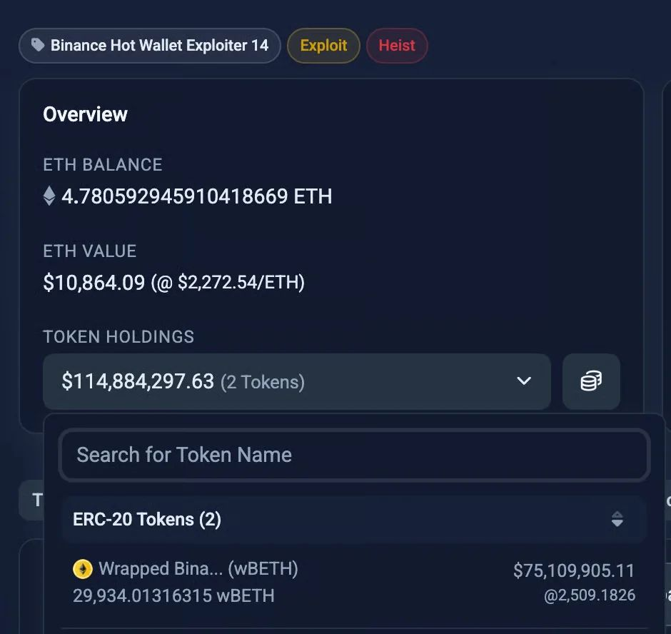
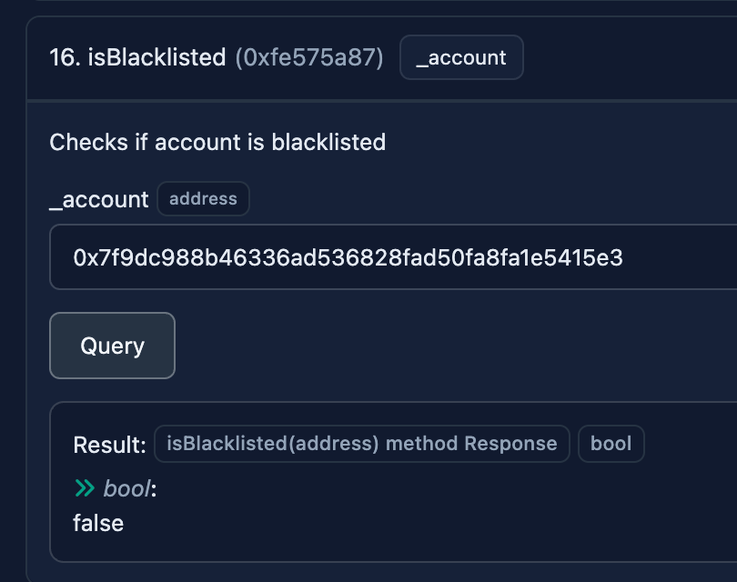
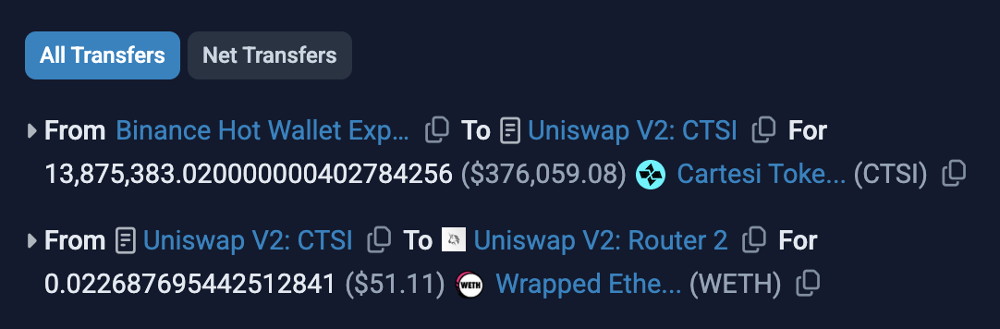
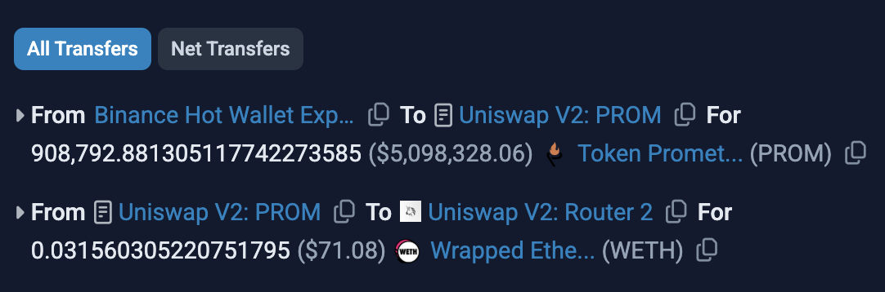
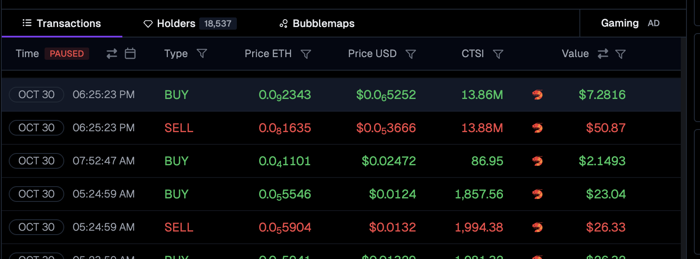
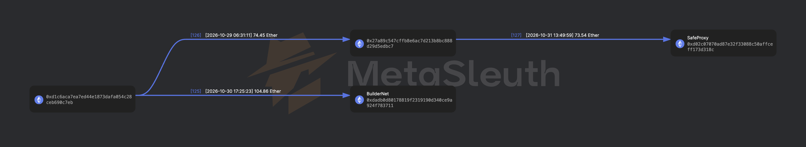
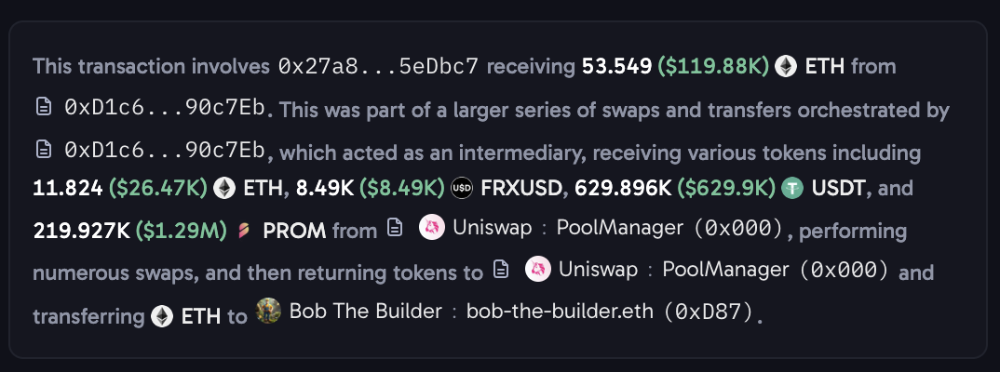

On Thursday, 29 October 2026, the biggest crypto hack in history happened. One of Binance’s hot wallets was exploited for about $6B in various cryptocurrencies.

It was past 10pm in Central Europe, where I live, and I was just about to go to bed when a friend posted about the hack in one of my group chats. I spent the next 3 hours glued to my computer screen, watching the aftermath of the attack unfold in real time.

### The forgotten freeze

Circle and Tether acted quickly, freezing USDC and USDT. 

I monitored the attacker’s wallets on Etherscan and noticed that the attacker was selling the tokens that weren’t frozen (mainly because they couldn’t be), starting with the biggest holdings first, such as UNI and LINK.

I glanced at the other tokens in attacker’s wallets and [one caught my eye](https://etherscan.io/address/0x7f9dc988b46336ad536828fad50fa8fa1e5415e3): wBETH (Wrapped Binance ETH), which is a token representing a share of staked ETH on Binance.

Since it’s a token issued by Binance, I assumed it could be frozen. 

I checked the token’s smart contract on Etherscan, more precisely the [read functions](https://etherscan.io/token/0xa2e3356610840701bdf5611a53974510ae27e2e1#readProxyContract), and looked for anything related to freezing addresses. Freeze function names aren't standardized, so they could be called anything: freeze, pause, blacklist, etc.

Binance used the name “isBlacklisted” for the function that reveals whether a given address is frozen for this particular token’s transfers. I entered the attacker’s wallet holding wBETH tokens, and saw this:

The query returned “false”, meaning the attacker's wallet hadn't been frozen yet. 

I imagine the first hour or so after the attack must have been very chaotic at Binance, and they simply forgot to freeze this asset.

I shared this with my friend who works in cybersecurity. Luckily, he has contacts at Binance and immediately notified them about the issue.

Within 10 minutes, the attacker's wallet was blacklisted. Which was just in time, because the attacker was nearly finished selling off LINK tokens, and wBETH was very likely next (based on the value of the holdings).

### The losing trades

The next morning, I decided to explore the attacker’s wallets further. I noticed the attacker was not done selling yet. They still held a lot of smaller token positions, and they weren't leaving anything behind.

As I was clicking through their recent transactions, I stumbled upon [one that didn’t make any sense](https://etherscan.io/tx/0x19c2a82ee1b801b5c2c9e41c0f9d599a81234c8098e1c35b49958f2eafd22a31). 

The attacker swapped $376k worth of Cartesi (CTSI) tokens and got back… $51 worth of ETH? What happened?

I copied the address of the Uniswap V2 pool used for the exchange and pasted it into [GeckoTerminal](https://www.geckoterminal.com/eth/pools/0x58eeb5d44dc41965ab0a9e563536175c8dc5c3b3). 

I quickly noticed the problem the attacker missed: **the pool only had $100 worth of liquidity**. I wondered if the attacker had run a script to sell tokens without any slippage control.

I went back to Etherscan and found another token with a similar fate: [PROM](https://etherscan.io/tx/0x38546f9087ba0eb8444965711eb64a89fe9f53e80cd6d416317c847308219164). This one cost the attacker even more: $5M worth of PROM was swapped for a mere $71 worth of ETH.

If North Korea really was behind the attack, I wouldn’t want to be the person responsible for these botched trades if the “Glorious Leader” found out about them. Unless he was the one doing them.

### The profit makers

So where did the money go? If you guessed charity, you’re wrong.

The value was obviously captured by MEV / block builders.

Cartesi tokens were bought for a mere $7 worth of ETH immediately after the attacker dumped them:

The buyer bought and sold them within [the same transaction](https://etherscan.io/tx/0x797f1b2a8892bd64a901658d72c64af87430c972fcb5b93102393e70055f0b69). 

They were sold through various pools with much deeper liquidity, netting about 104 ETH for a block builder [BuilderNet](https://buildernet.org/), and 74 ETH for an unknown wallet that stashed the proceeds into a Safe wallet.

As for the PROM tokens, [Arkham](https://arkm.com/) says they were purchased from that low-liquidity pool (and then swapped for ETH in pools with deeper liquidity) by a famous block builder [BobTheBuilder](https://bobthebuilder.xyz/):

### The newfound passion

I’ve been a software developer for over 15 years. But programming isn’t what it used to be.

Since the beginning of this year, AI coding has become so good that it doesn’t make sense to write code by hand anymore. Even seasoned programmers like myself now develop by writing prompts to AI.

Over the past few months, I’ve been doing some soul-searching and learning various new things: from 3D printing and electrical engineering to chemistry and healthtech.

But the thing that really ignited a spark was this research I did on the Binance hack. There’s something exciting about following breadcrumbs and uncovering the truth. This might be my next adventure - let’s see where it leads me.
